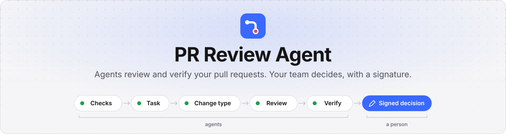
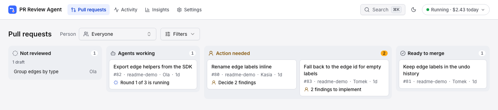
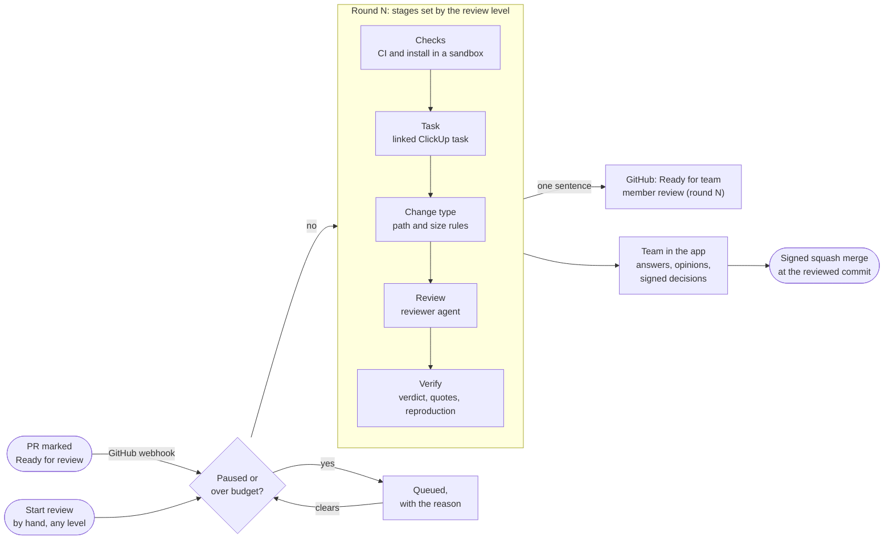
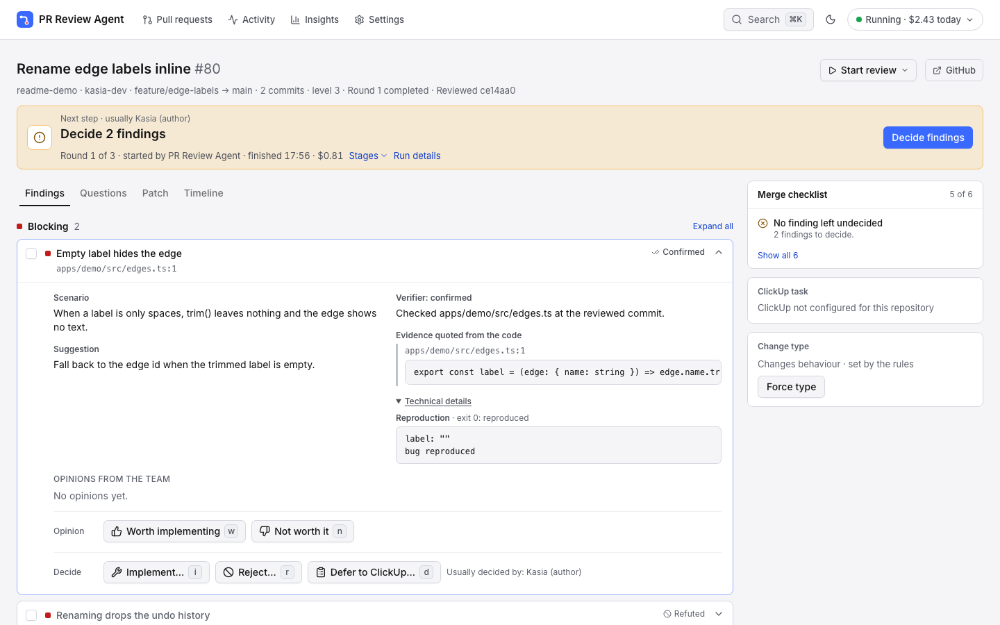
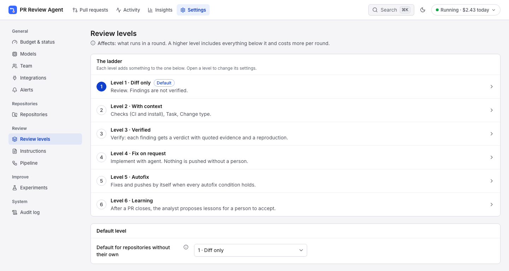
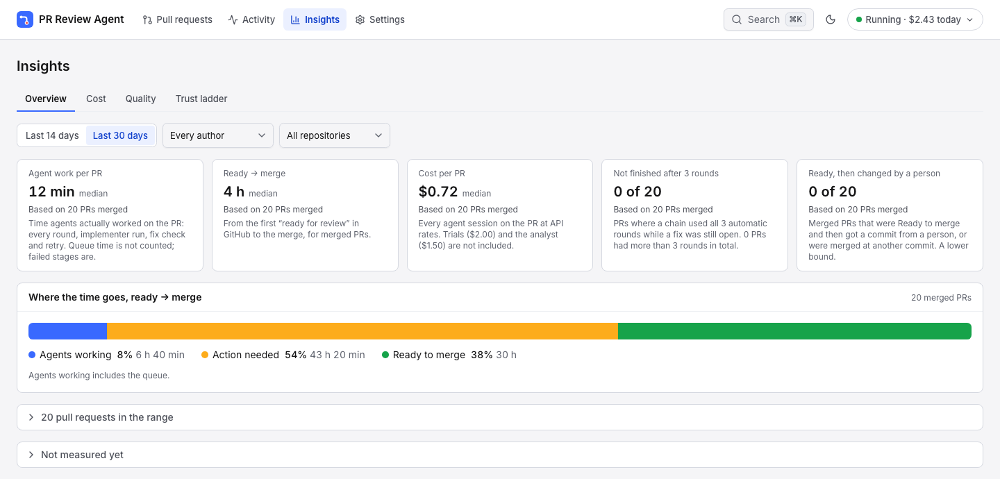

<div align="center">

<picture>
  <source media="(prefers-color-scheme: dark)" srcset="docs/assets/readme/hero-dark.svg">
  
</picture>

**Agents review and verify your team's pull requests, with proof. People decide, with a signature.**

[](https://github.com/alek-kowal/pr-review-agent/actions/workflows/ci.yml)


[Why](#why) · [How it works](#how-it-works) · [Screenshots](#screenshots) ·
[Features](#features) · [Quick start](#quick-start) · [Architecture](#architecture) ·
[Configuration](#configuration) · [Development](#development) · [Docs](#docs)

<br>

<picture>
  <source media="(prefers-color-scheme: dark)" srcset="docs/assets/readme/board-dark.png">
  
</picture>

</div>

## Why

A review only helps when acting on it is faster than reading the PR in GitHub. Our two earlier
prototypes ran about 70 paid rounds in five days, 87% of them at the lowest level, so almost no
finding was checked. Four rounds died at a timeout and were paid for again, the team recorded 4
decisions in total, and everything happened under one person's name, in one hard-wired
repository.

PR Review Agent fixes that:

- **Agents do the work.** They review, verify each finding against the code and track its fix.
  A person steps in only where an agent cannot decide.
- **Every opinion and decision is signed** by a Team member picked in the action's own form. No
  personal accounts: each decision carries the signer's name, and every settings change lands in
  the Audit log.
- **Any repository, by settings alone.** No code path is specific to one repository.
- **Spend stays visible.** Live cost per turn, a daily budget and a pause; costs shown are always
  real spend, never estimates.

> [!NOTE]
> Pilot build. All six review levels work today, from diff-only review to autofix and learning.
> Hosting is not chosen yet: run it locally.

## How it works



1. A PR turns **ready for review** (or someone clicks **Start review**). A push alone never starts
   a paid review.
2. The worker runs one **round** as pg-boss jobs, one per stage. The PR's **review level** decides
   which stages run; the board shows live progress and cost.
3. The reviewer reports up to 7 **findings** and its questions. At level 3 the verifier gives each
   finding a verdict (Confirmed, Refuted, Not proven) with quoted code and a sandboxed
   reproduction.
4. The bot posts exactly one sentence on the PR. Findings, opinions and decisions stay in the app.
5. The team answers questions, gives signed opinions and **decides** (Implement, Reject, Defer to
   ClickUp). When the checklist is green, a person merges from the app at the reviewed commit.

| Level | Name           | Adds                                                                 | Today |
| ----- | -------------- | -------------------------------------------------------------------- | ----- |
| 1     | Diff only      | Review. Findings are not verified                                    | Yes   |
| 2     | With context   | Checks (CI and install), Task, Change type                           | Yes   |
| 3     | Verified       | Verify: a verdict with quoted evidence and a reproduction            | Yes   |
| 4     | Fix on request | Implement with agent; nothing is pushed without a person             | Yes   |
| 5     | Autofix        | Fixes and pushes by itself when every autofix condition holds        | Yes   |
| 6     | Learning       | After a PR closes, the analyst proposes lessons for a person to keep | Yes   |

## Screenshots

Taken from the real app on the e2e test stack (`pnpm readme:shots`); light or dark follows your
GitHub theme. Click one for full size.

<table>
  <tr>
    <td width="33%" valign="top">
      <a href="docs/assets/readme/pr-findings-light.png"><picture>
        <source media="(prefers-color-scheme: dark)" srcset="docs/assets/readme/pr-findings-dark.png">
        
      </picture></a>
      <br><sub><b>PR page.</b> A verified finding with quoted code, a reproduction and the signed decision.</sub>
    </td>
    <td width="33%" valign="top">
      <a href="docs/assets/readme/settings-levels-light.png"><picture>
        <source media="(prefers-color-scheme: dark)" srcset="docs/assets/readme/settings-levels-dark.png">
        
      </picture></a>
      <br><sub><b>Settings.</b> The review level ladder; every signed change lands in the Audit log.</sub>
    </td>
    <td width="33%" valign="top">
      <a href="docs/assets/readme/insights-light.png"><picture>
        <source media="(prefers-color-scheme: dark)" srcset="docs/assets/readme/insights-dark.png">
        
      </picture></a>
      <br><sub><b>Insights.</b> The five pilot metrics, each with its sample size.</sub>
    </td>
  </tr>
</table>

## Features

| Area                    | What ships today                                                                                                                                  |
| ----------------------- | ------------------------------------------------------------------------------------------------------------------------------------------------- |
| **Rounds**              | Round 1 starts when a PR turns ready; anyone starts a round by hand at any level. A push by a person never starts one.                            |
| **Findings**            | Severity, file and line, scenario and suggestion; at level 3 a verdict with quoted code and a reproduction.                                       |
| **Questions, opinions** | Answer the reviewer's questions, give signed opinions, save them as one signed review and notify the author in ClickUp.                           |
| **Decisions**           | Implement, Reject (with a reason) or Defer to ClickUp, for many findings with one signature; deferred findings become ClickUp tasks.              |
| **Board**               | Four lanes from one state table, urgency sort, filters in the URL, command palette (⌘K), keyboard triage, light and dark theme.                   |
| **Live view**           | Stepper and cost per turn over SSE, Timeline, Activity, and Run detail with each agent's transcript.                                              |
| **Safety rails**        | Sensitive files need a person's OK. Retry from the failed stage, cancel that stops spend, pause, daily budget, agent slots, queue with reasons.   |
| **Merge**               | A merge checklist, then a signed squash merge pinned to the reviewed commit; never bypasses branch protection.                                    |
| **Instructions**        | Versioned review instructions per scope, trial runs with Compare, and a read-only pipeline diagram.                                               |
| **Alerts**              | A failed run, a chain out of rounds, an expensive PR or the daily budget, as ClickUp comments you can dismiss.                                    |
| **Learning**            | At level 6 the analyst reads a closed PR and proposes lessons; a person edits and accepts them, signed, into the lessons file the reviewer reads. |
| **Insights**            | Five pilot metrics with sample sizes, plus Cost, Quality and the Trust ladder.                                                                    |
| **Settings, audit**     | Repositories, Team, models per role, review levels, budget, integrations, alerts and learning; every signed change in the Audit log.              |

**Also shipped:** Implement with agent and patch review (level 4), signed push and level 5
autofix with a shadow log, and read-only review of fork PRs. **On the roadmap:** a hosted
deploy. See
[the roadmap](context/foundation/roadmap.md) and the
[work packages](context/foundation/work-packages.md).

## Quick start

You need Node 24, pnpm 12 and Docker.

```bash
pnpm install
cp .env.example .env               # set DATABASE_URL; the local value is in the comment
docker compose up -d db            # one Postgres 17 for every worktree
pnpm db:migrate                    # Drizzle migrations, pg-boss and its queues
pnpm --filter @pra/api dev         # http://localhost:3000
pnpm --filter @pra/worker dev
pnpm --filter @pra/web dev         # http://localhost:5173
```

Then open http://localhost:5173/prs. To review real PRs the worker needs model access and the
GitHub App variables below. Model access is one of two (without either, runs fail with "model
access not configured"):

- `CLAUDE_CODE_OAUTH_TOKEN`: a Claude subscription (Pro or Max). Create the token with
  `claude setup-token`. Costs in the app read "API-equivalent" (what the tokens would cost on the
  API) and the daily budget guards that number. When the subscription's usage limit is reached,
  reviews pause until just after the reset ("Paused until 15:01: Claude usage limit") and go on
  by themselves; the session that hit the limit is not a failed attempt.
- `ANTHROPIC_API_KEY`: the pay-per-token Anthropic API.

With both set the subscription wins. The worker's start log says `model access configured` and
the mode; the status chip and Settings → Budget & status show it. There is no fake or demo mode.

<details>
<summary><b>Connect a repository</b></summary>

A repository differs from another only by its settings, never by code.

1. Install the GitHub App on the repository (GitHub → the App → Configure → Repository access).
2. Settings → Repositories → Connect a repository: pick it from the repositories the App can
   reach.
3. Set the default review level, the default branch, the fetch and install commands, ClickUp (or
   off), sensitive files with their reasons and the change-type rules. Connect and sign: the change
   lands in the Audit log.
4. Its next ready-for-review PR starts round 1 with these settings. Settings → Integrations shows
   its webhook deliveries.

</details>

## Architecture

A pnpm monorepo in TypeScript. The api takes webhooks and serves the SPA's data; the worker runs
each round as pg-boss jobs, one per stage, and calls the agents.

| Path                    | Package             | What it holds                                                                                        |
| ----------------------- | ------------------- | ---------------------------------------------------------------------------------------------------- |
| `apps/web`              | `@pra/web`          | Vite + React 19 SPA, TanStack Router and Query, Tailwind, shadcn/ui                                  |
| `apps/api`              | `@pra/api`          | Fastify API with Zod schemas and an OpenAPI document; GitHub webhooks; SSE for live updates          |
| `apps/worker`           | `@pra/worker`       | pg-boss jobs, one per round stage, plus alerts and the reconcile poll                                |
| `packages/core`         | `@pra/core`         | Pure domain rules: PR states, the run state machine, levels, reason codes. No I/O                    |
| `packages/db`           | `@pra/db`           | Drizzle schema, migrations and queries                                                               |
| `packages/integrations` | `@pra/integrations` | `GitHubGateway`, `ClickUpGateway`, `BlobStore`, `GitMirror`, `Sandbox`, logging                      |
| `packages/agents`       | `@pra/agents`       | `AgentRunner` (Claude Agent SDK) and the reviewer, verifier, implementer, judge and analyst adapters |
| `e2e`                   | Playwright          | End-to-end specs on a test stack with doubles (`e2e/support/`)                                       |
| `deploy`                | Docker Compose      | One-VM deploy: Caddy with the SPA, api, worker; see [deploy/README.md](deploy/README.md)             |

The rules that keep it this way are lint errors: `packages/core` imports no Node APIs and no other
`@pra/*` package with I/O, `apps/web` imports only `@pra/core`, and every integration sits behind
its interface. The reviewer and the verifier only read the worktree, and no agent gets a shell.
PR code runs only in a Docker sandbox with no network, a read-only root and CPU, memory and time
limits.

## Configuration

Names live in [`.env.example`](.env.example), values only in the gitignored `.env` (hosted: a
secret store). The api and the worker read the root `.env`.

<details>
<summary><b>Environment variables</b></summary>

| Name                                                                                   | What it does                                                   |
| -------------------------------------------------------------------------------------- | -------------------------------------------------------------- |
| `DATABASE_URL`                                                                         | Postgres connection                                            |
| `CLAUDE_CODE_OAUTH_TOKEN`                                                              | Model access on a Claude subscription (wins over the key)      |
| `ANTHROPIC_API_KEY`                                                                    | Model access for the agents (pay-per-token)                    |
| `GITHUB_APP_ID`, `GITHUB_APP_PRIVATE_KEY_PATH`, `GITHUB_WEBHOOK_SECRET`                | The GitHub App: installation tokens and webhook signatures     |
| `CLICKUP_API_KEY`                                                                      | Optional: tasks, follow-ups, author notices and alert comments |
| `APP_BASE_URL`                                                                         | The app's address, for links in ClickUp alert comments         |
| `BLOB_DIR`                                                                             | Local blob store folder (default `.data/blobs`)                |
| `S3_BUCKET`, `S3_ENDPOINT`, `AWS_ACCESS_KEY_ID`, `AWS_SECRET_ACCESS_KEY`, `AWS_REGION` | S3-compatible blob store for diffs, transcripts and raw events |
| `DATA_DIR`                                                                             | Worker: git mirrors and session files (default `.data`)        |
| `SANDBOX_DOCKER_HOST`                                                                  | Worker: the Docker daemon for sandboxes (rootless on Linux)    |
| `TRUST_PROXY`                                                                          | Api: proxies whose `X-Forwarded-*` headers count               |
| `SENTRY_DSN`, `SENTRY_ENVIRONMENT`, `SENTRY_RELEASE`                                   | Error reporting                                                |
| `OTEL_EXPORTER_OTLP_ENDPOINT`                                                          | Traces                                                         |
| `WORKER_HEARTBEAT_FILE`                                                                | Worker container healthcheck, set by `deploy/compose.yaml`     |
| `S3_TEST_ENDPOINT`                                                                     | Tests only: MinIO for the S3 blob store tests                  |

</details>

## Development

| Command                         | What it does                                                             |
| ------------------------------- | ------------------------------------------------------------------------ |
| `pnpm verify`                   | Lint, typecheck and test in parallel. Run it before you commit           |
| `pnpm lint` / `pnpm format`     | ESLint, Prettier and the repository-agnostic check / fix formatting      |
| `pnpm test`                     | Vitest over all packages; each run creates and drops its own database    |
| `pnpm test:e2e`                 | Playwright (Chromium) on the test stack with doubles                     |
| `pnpm readme:shots`             | Retakes the README screenshots in `docs/assets/readme/`                  |
| `pnpm db:generate`              | Writes a migration after a schema change                                 |
| `pnpm db:seed-repo <seed.json>` | Bootstraps a repository from a seed file (connect real ones in Settings) |
| `pnpm instructions:import`      | Imports instruction files as version 1; safe to run again                |

> [!TIP]
> `pnpm test` and `pnpm test:e2e` need the database: `docker compose up -d db`.

House rules are in [AGENTS.md](AGENTS.md): UI copy only in `apps/web/src/copy`, reason codes
instead of prose from core, signed settings writes through one function, no runtime fake mode,
test doubles only in tests.

## Docs

| Document                                                                                  | What is in it                                                                      |
| ----------------------------------------------------------------------------------------- | ---------------------------------------------------------------------------------- |
| [PRD](context/foundation/prd.md)                                                          | Problem, personas, user stories, requirements and business rules                   |
| [Roadmap](context/foundation/roadmap.md) and [tasks](context/foundation/roadmap-tasks.md) | Slices, tasks and what is done                                                     |
| [Work packages](context/foundation/work-packages.md)                                      | How the roadmap is built in parallel, and the steps only a person can do           |
| [Tech stack](context/foundation/tech-stack.md)                                            | Every stack choice and why                                                         |
| [Brief](docs/00-brief.md) and [analysis](docs/01-analysis.md)                             | The prototypes this rewrite replaces, and what we learned from them                |
| [Design decisions](docs/03-design-decisions.md)                                           | The approved UI structure behind the prototype in [`prototype/`](prototype/)       |
| [Accounts and signatures](docs/04-accounts-and-signatures.md)                             | One shared account, signed actions                                                 |
| [Review triggers](docs/05-review-triggers.md)                                             | Reviews start when a PR is ready or on demand; only our own fix commits re-trigger |
| [Metrics](docs/06-metrics.md)                                                             | The pilot metrics and alerts                                                       |
| [Deploy](deploy/README.md)                                                                | The one-VM Compose deploy                                                          |
