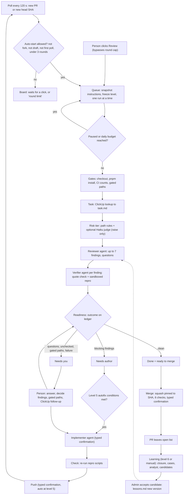
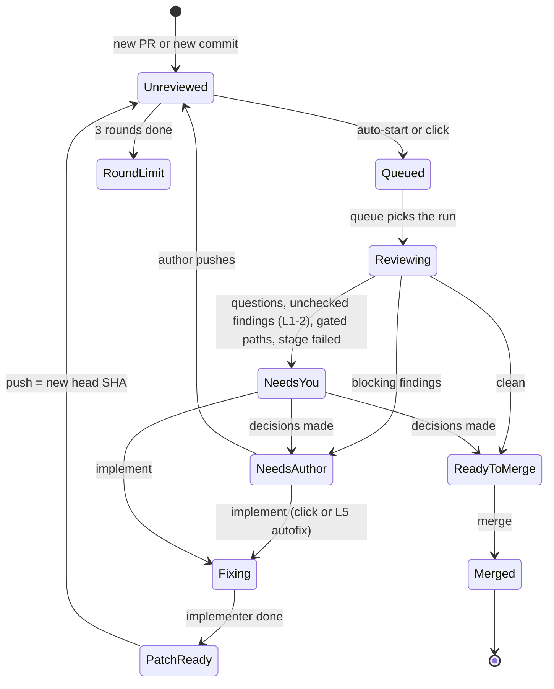
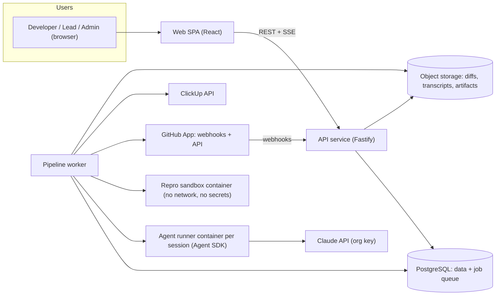

# WB Factory: analysis before the production rewrite

*Date: 2026-11-18. Input: `00-brief.md`, plus Alek's answer: the production app is internal to Synergy (one organisation, a few to a dozen developers plus a lead, our own repos), it does not need multi-tenancy but must not block it later, and designs will be a clickable HTML prototype.*

**How this was produced**
- Both repos were read in full by four subagents: plain core, WB orchestration, UI/UX, and tests plus knowledge.
- The SQLite databases were queried read-only.
- Live pages were fetched with GET only. Before any fetch, the route handler was read to confirm that the GET has no side effects.
- No POST was sent and nothing was restarted.
- Both test suites were run on scratch copies: plain **98/98 pass**, WB **88/88 pass**.
- Some admin GETs were deliberately not fetched. `versions.active()` (`wb-factory/src/versions.ts:53-66`) writes a new version row when a file on disk has changed, so even a GET can write to the team's database.
- Paths:
  - **P** means `~/Projects/wb-factory`.
  - **W** means `~/Projects/wb-factory-wb`.
  - `file:line` references are relative to each repo's `src/`.

---

## 0. In one screen

- **What it is.** WB Factory polls GitHub for one repo (`synergycodes/workflowbuilder`) and runs a paid AI review round on each new head commit. The round has these stages:
  1. checkout and gates
  2. ClickUp task
  3. risk tier
  4. reviewer agent
  5. verifier agent per finding
  6. a code-only readiness decision

  The board then sorts PRs by whose move it is. A person answers questions, decides on findings, and can start an implementer agent, push and merge, each behind a confirmation page. Six "review levels" switch stages on gradually: level 5 auto-fixes and level 6 learns from closed PRs.
- **How it is really used.** This comes from the databases.
  - In 5 days there were about 70 review rounds across the two instances, about $87 by the CLI's counter, roughly $1.30 per round and 2.5 minutes.
  - **87% of rounds ran at level 1.** That means no verifier, so almost every finding is "unverified".
  - Humans have recorded **4 finding decisions in total**, all in W. They answered 1 question in P and 3 in W.
  - 0 lessons have been accepted.
  - **4 of 30 rounds failed** at the 30-minute agent timeout, on the same big PRs in both versions.
- **Which base to use.** Neither codebase, as code. The plain version is the better *reference*: it is the original, has one source of truth and the newest domain logic, and its 98 tests encode the rules. W is about 75% a copy of P with a Temporal/Workflow Builder layer that adds a second and third source of truth. It also adds a valuable idea: the live run view. **Rewrite fresh. Port P's domain core and tests. Take W's run-view and snapshot ideas. Do not carry the in-process Temporal or the editable diagram.**
- **Target.** A TypeScript monorepo with:
  - a React SPA
  - a Fastify API
  - PostgreSQL holding both the data and the job queue (pg-boss)
  - a pipeline worker running stages as durable jobs
  - agents on the **Claude Agent SDK with an organisation API key**, in per-run containers
  - a GitHub App with webhooks
  - GitHub OAuth login with three roles

  Temporal is the strongest alternative. It wins only if Synergy already runs a Temporal cluster this tool can share (Open question 1).
- **Production blockers in today's approach.**
  - `claude -p` runs on one person's subscription.
  - There is one personal GitHub token.
  - There is no authentication, and the repro sandbox is allowed to reach `localhost`, where that unauthenticated dashboard listens.
  - The sandbox is macOS-only (`sandbox-exec`).
  - The SQLite store with a single checkout ties everything to one machine.
  - Status is driven by free-text Polish strings.
- **Design input.** Section 5 lists every screen, the 25 most important UX problems, a proposed navigation (Inbox · Pull requests · Activity · Insights · Settings), a screen list for the prototype, and 5 key flows step by step.

---

## 1. Process map

### 1.1 Actors

| Actor | Kind | What it does | Identity today |
|---|---|---|---|
| PR author | Person | Opens and updates the PR; should fix "needs author" findings | GitHub user. **The factory never tells them anything.** The only GitHub write is the merge (`P github.ts:101`) |
| Reviewer / lead ("Ty", you) | Person | Starts rounds, answers questions, decides findings and gated paths, starts the implementer, pushes, merges | **Anonymous.** No login. Every GitHub action uses one token, and history records the token owner (`P pages.ts:133,165`) |
| Factory admin | Person | Tunes instructions, levels, models, budget; runs trials; curates lessons | Anonymous; audit rows have no actor (`P versions.ts:23`) |
| Poll loop | System | Every `POLL_SECONDS` (120): sync open PRs, auto-queue rounds, queue learning when a PR closes (`P server.ts:147-174`) | n/a |
| Task judge (classifier) | Agent, `haiku` by default | Reads `task.md` + changed files and can only *raise* the risk tier (`P classify.ts:261-274`) | Server's `claude` login |
| Reviewer | Agent | Reads the repo and brief; up to 7 findings, questions, "not checked" (`P review.ts:33-88`) | Server's `claude` login, model `opus` |
| Verifier | Agent, one session per finding | Tries to refute a finding; must quote code; may write a repro script (`P verify.ts:126-176`) | Server's `claude` login, different model intended (`P review.ts:106`) |
| Implementer | Agent | Edits a separate clone; no shell (`P implement.ts:254-304`) | Server's `claude` login; commits as the token owner + `Co-Authored-By: Claude` |
| Analyst | Agent | After a PR closes, proposes at most 5 lesson candidates (`P analyst.ts:5-29`) | Server's `claude` login |
| GitHub | External | PRs, check runs, reviews, comments, merge API, git clone/fetch/push | PAT or `gh auth token --user`, read **once at startup** (`P server.ts:37-41`). Clone is anonymous, so **only public repos work** (`P checkout.ts:18`) |
| ClickUp | External | Task lookup (by link, or a search for the PR URL), follow-up task creation | One API key |
| Claude | External | All agent sessions via `claude -p` | The OS user's Claude login, with the full env inherited (`P agent.ts:53`) |
| Temporal (W only) | Infra | Dev server started in-process by `@temporalio/testing` (`W server/main.ts:101-103`) | n/a |

### 1.2 Triggers

| Trigger | What starts | Notes |
|---|---|---|
| New PR or new head SHA seen by the poll | A review round | Not for drafts or forks. Not on the first poll of an empty board (`P server.ts:152`). Not with `AUTO_REVIEW=0`. Not after 3 rounds with a result: the PR then gets "round limit" status (`P server.ts:45,163-169`) |
| "Zrób review" / "Review ponownie" button | A review round, at the chosen level | **Paid, one click, no estimate**. Bypasses the 3-round cap (`P pages.ts:412-417`) |
| Level 5 readiness branch "needs author" + all autofix conditions | Implementer, then auto-push | No click (`P autofix.ts:50-96`) |
| "Zaimplementuj" + typed PR number | Implementer (level ≥4) | Separate in-memory lane (`P autofix.ts:132-147`) |
| PR leaves the open list | Learning run | Only if the PR's last level has `learning` (level 6) and auto-review is on (`P server.ts:154-160`). Or manually from `/admin/lessons` |
| "Uruchom próbę" / "Sprawdź na PR-ze" / "Wypróbuj" | 1 or 2 trial rounds | Each costs a full round |
| Timers | `queue.drain()` every 60 s | Re-checks pause and budget |

Nothing uses webhooks.

### 1.3 Stages (one review round)

| # | Stage | Runs | Input | Output | Side effects | Off below level |
|---|---|---|---|---|---|---|
| 0 | Queue | code | PR, chosen level/tier | `runs` row, frozen level, knowledge snapshot copied to `work/runs/<id>/knowledge` (`P queue.ts:97-124`, `versions.ts:114-129`) | One run at a time (shared checkout) | – |
| 1 | GitHub | code | PR number | round number, head SHA | History line | – |
| 2 | Gates | code | PR | `diff.patch`, CI counts, gated paths, changed-package docs | `git fetch/checkout` in shared `work/repo`; `pnpm install --frozen-lockfile --ignore-scripts` unless fork (`P review.ts:174-195`) | 2 |
| 3 | Task | code | PR, link | `task.md` | Auto-links a ClickUp task found by searching 10 pages / 90 days (`P clickup.ts:16-54`) | 2 |
| 4 | Risk tier | code + optional agent | changed paths, lines, task | `composes` / `extends` / `one-way` + rule fired | One-way adds a pseudo gated path | 2 (level fixes the tier) |
| 5 | Reviewer | agent (opus) | brief: PR, task, CI, gated paths, level text, tier limits, **earlier human answers (not earlier findings)** | ≤7 findings, questions (2–3 options + recommended), ≤5 "not checked", gated notes | `enforce()` cuts to tier limits; `fix.before` dropped if not in file (`P review.ts:255-296`) | – |
| 6 | Verifier | agent per finding | finding *without* the reviewer's fix, diff, task, docs | verdict, reason, quoted evidence, optional `script`, `remedy` obvious/decision | Quote check in code; script run under `sandbox-exec` (5 min); exit 0 = confirmed, 3 = refuted, script beats agent; 1 repair attempt (`P verify.ts:75-176`) | 3 (findings stay "unverified") |
| 7 | Readiness | code | ledger | PR column + status (`P outcome.ts:7-60`) | – | 3 (without it every unverified finding goes to the person) |
| 8 | Autofix decision | code | ledger | go / reason; at lower levels only logs "what level 5 would do" | Starts implementer lane | 5 |
| 9 | Human | person | PR page | answers, decisions, gate decision | ClickUp follow-up on "defer" | – |
| 10 | Implementer → Check → Push | agent + code | chosen findings | local commit on `work/impl`; "check" = re-run repro scripts that exited 0 | `git push` (not forced), refused if head moved (`P implement.ts:310-335`) | 4 |
| 11 | Merge | code | fresh GitHub state | squash merge pinned to reviewed SHA | Requires 6 readiness conditions (`P readiness.ts:13-35`) | – |
| 12 | Learning | code + agent | closure (GitHub status + human comments), `cases.json` from ledger | ≤5 lesson candidates, deduplicated via `sameAs` | Accept → appended to `lessons.md` as a new version | 6 |

### 1.4 Diagram



### 1.5 Human decision points

| # | Decision | Where | Effect |
|---|---|---|---|
| 1 | Start or repeat a review, choose level (and tier on `/pr/:n/runs`) | PR page action bar | Paid round; level is frozen per run |
| 2 | Answer a reviewer question (option or free text) | PR page "Pytania do ciebie" | Changes the column; fed into the next round's brief (`P review.ts:264-267`) |
| 3 | Decide on findings, one or many: **Fix** (`accepted`, blocks even a nit), **Dismiss** (reason required), **Defer + ClickUp task** (reason required) | PR page bulk bar | Changes the column; the reasons are the learning signal |
| 4 | Gated paths: accept or send back with a comment | P `/pr/:n/gates`; W run page, output of node "Ty" | Accept stands in for the gate; return → needs author; a new round asks again |
| 5 | Implement selected findings (level ≥4), revise with a note, edit or revert files by hand | Confirmation page; patch section | Implementer session; patch squashed into one commit |
| 6 | Push patch / merge | Confirmation pages (type PR number) | GitHub write as the token owner |
| 7 | Admin: models, budget, pause; instruction versions; levels; trials; lessons | `/admin/*` | Affects every future run |

### 1.6 States

The code stores **4 PR states** (`working`, `needs_human`, `needs_author`, `done`). Everything else lives in free-text Polish `status` strings, which other code then pattern-matches (`P flow.ts:12`, `outcome.ts:39`, `queue.ts:64-67`). The logical states are:



| Logical state | Stored state + status text (examples) | Board column today |
|---|---|---|
| Unreviewed | `working` "Czeka na review" (`P sync.ts:16`) | "Agenci pracują" (agents working). **Wrong: no agent is working.** Live: 13–14 of 21 open PRs |
| Queued / Reviewing / Verifying | `working` "W kolejce…", "Review trwa", "Weryfikacja trwa" | Agents working |
| Needs you | `needs_human` "Pytania: N", "Uwagi do przejrzenia: N", "Etap … się nie udał", "Przebieg przerwany", "Limit 3 rund…" | "Czeka na ciebie" |
| Needs author | `needs_author` "Do poprawy: N", "Odesłane do autora" | "Czeka na autora" |
| Fixing / Patch ready | `working` "Implementator pracuje" → `needs_human` "Poprawka czeka na wypchnięcie" | Agents working → Needs you |
| Ready to merge | `done` "Bez uwag" / "Gotowe z uwagami" | "Gotowe" (done), **although merging is still a human move** |
| Merged | `done` "Zmergowany" | Done |
| Closed | `open = 0`, state unchanged | Hidden |

**Other status sets**
- **Run:** `queued → running → completed | failed`, and `queued → cancelled`. W adds the engine's `pending, waiting, cancelling, incomplete`.
- **Stage:** `running → done | failed`. `skipped` exists but is never written (`P runs.ts:149`).
- **Finding:**
  - The verifier sets `unverified → open | refuted | unverified`.
  - A human sets `accepted | declined | deferred`.
  - `fixed` is never set (`P store.ts:72`).
- **Patch:** `ready → pushed`, or `failed`.
- **Candidate:** `proposed → accepted | rejected`.
- **Gate decision:** `approve | return`.

### 1.7 What costs money

Every agent session is a `claude -p` session on the **Claude subscription of the OS user running the server** (no API key read). The recorded `costUsd` is the CLI's API-equivalent `total_cost_usd`. On a subscription that figure measures usage, not money billed.

| Action | Sessions | Measured cost (DBs, 13–18 Nov) |
|---|---|---|
| Review round, level 1–2 | 1 reviewer (+ Haiku judge at L2+, which has never run) | P: 32 paid sessions, **$45.67**, average $1.43, max $3.33, average 2.5 min. W: 34, **$41.67**, average $1.23 |
| Review round, level 3+ | + 1 verifier per finding (+1 repair attempt) | Example: PR #264, 2 findings: $0.97 review + $0.36 verify (W README:20). P total verifier spend: $3.01 |
| Implementer / revise | 1 per click (or autofix) | W: one patch on #270, $0.11; P: none |
| Analyst | 1 per closed PR (level 6 or manual) | $0.07 (one run) |
| Trial / "Sprawdź na PR-ze" | 1 / 2 full rounds | Same as rounds |

Where the spend went:
- **The reviewer is ~92% of spend** (P stages: reviewer $33.88, verifier $3.01, analyst $0.07).
- **Both instances review the same 28 PRs**, so the team pays twice: about $17/day combined.
- Failed sessions record **no cost** although they ran up to 30 minutes (`P agent.ts:53-62`: on a non-zero exit the stdout JSON is lost).

Budget controls:
- A daily budget, 0 = unlimited (live: no limit set), and a pause.
- Both are checked **only before a run starts** and at implement clicks (`P queue.ts:79`, `pages.ts:77,177`), never per session. One level-3 round with 7 findings can launch up to 14 verifier sessions.

**Rough team estimate for production.** This assumes API billing at the measured per-round cost. 10–25 rounds per workday × $1.3–1.8 × 21 workdays comes to **about $280–$950 per month**. Level 3+ adds about $0.18 per verified finding. The reviewer dominates, so prompt caching and diff scoping matter more than the choice of verifier model.

### 1.8 Failure and retry paths

| Failure | What happens now | Evidence |
|---|---|---|
| Agent timeout, crash or malformed JSON | Stage and run `failed`, PR → needs you "Etap … się nie udał". **No retry** by design ("a retry bills a whole session again", `P stages.ts:53`, `W profiles.ts:3`). The stored error is the 2.6 KB command line, not the cause | 4 of 30 P rounds and 4 W rounds failed this way: reviewer killed at the 30-min timeout (`P agent.ts:55`), on the same PRs #239/#262/#265 in both. Big PRs do not fit |
| Recovery | Only "Review ponownie": a whole new paid round. No retry of one stage | W README:201 |
| GitHub / ClickUp HTTP error | Throws; no retry, no rate-limit handling, no fetch timeout. A ClickUp search error fails the whole round | `P github.ts`, `clickup.ts` |
| More than 100 open PRs | No pagination: the extra PRs look closed and get learning runs | `P github.ts:48` |
| Restart during a run (P) | `running` runs → failed, PR → needs you "Przebieg przerwany"; queued runs survive. **The implementer lane is in memory: lost, and the PR stays "Implementator pracuje" forever** | `P server.ts:118-122`, `autofix.ts:132-147` |
| Restart during a run (W) | Parked runs survive (Temporal). A crashed agent activity has 1 attempt and no heartbeat, so it is noticed only at its timeout (reviewer 35 min, verifier 4 h). Meanwhile the queue is blocked | `W profiles.ts:4-13`, `queue.ts:57` |
| Cancel | P: only queued runs. W: cancels the workflow, but **the `claude` process keeps running and still writes findings to the ledger** | W README:202; W review §5 |
| New round while an earlier one is parked (W) | The earlier run is cancelled. Closing a PR does **not** cancel its parked run | 14 cancelled; 13 parked, 6 of them for closed PRs |
| Round limit | PR → needs you "Limit 3 rund: zdecyduj, co dalej", with **no "what next" action** on the page | 4 live PRs |

### 1.9 Corrections to the brief's summary

| Brief says | Code says |
|---|---|
| "AI review round (reviewer finds, verifier checks each finding)" | The verifier runs only at level ≥3, and at tier `composes` only on blockers. **The default level is 1, and 87% of real rounds ran at level 1**, so in practice there is no verification |
| "Optional ClickUp task" | ClickUp is mainly *read* for context, and tasks are auto-linked by search. A task is created only when a finding is **deferred** and the PR already has a linked task (`P pages.ts:270-286`) |
| "Push/merge behind confirmation pages" | True for clicks. **The level-5 autofix push has no confirmation**, and level 6 inherits autofix (`P levels.ts:233-269`) |
| "Analyst proposes lessons, which update the instruction files" | The analyst only proposes. A human must accept a candidate, which then appends to `lessons.md`. 0 have been accepted so far. Learning runs only at level 6 or by hand |
| "Implementer agent" | No shell, runs no tests or lint. "Check" re-runs only the verifier's repro scripts. Findings confirmed by quote alone have no script, so a level-5 push can go out with no code executed |
| "Logged-in user's Claude subscription" | The *server OS user's* `claude` login, with the full env inherited. An `ANTHROPIC_API_KEY` in env would silently switch billing to the API |
| (implied) the live apps run the code in the repos | **The P server (:4300) runs code from before 16 Nov**: process started 14 Nov 20:07; `store.ts`, `autofix.ts`, `verify.ts`, `runs.ts`, `server.ts` changed 16 Nov. The `remedy` and `auto` columns are missing from its DB, and the live level picker shows 5 levels while the source has 6. **Level-5 autofix and verifier `remedy` have never run live** |

---

## 2. Version comparison

### 2.1 Table

| Dimension | Plain, P (`wb-factory`) | Workflow Builder, W (`wb-factory-wb`) |
|---|---|---|
| **Domain coverage** | Full and the newest: gated-path page `/pr/:n/gates`, `roundOf` for failed reviews, `/admin/run/:id` debug page | Same domain, copied 14 Nov, partly back-ported since and drifting. Adds the live run canvas, per-stage output renderers, diagram editor, gated decision on the run page. Lacks P's run debug page |
| **Code size** (TS lines) | ~7,860 + 1,119 CSS: pipeline/domain 2,673 · integrations 277 · persistence 865 · board UI 1,202 · admin/levels/versions/docs 2,550 · wiring 295. Separate diagram app 629 | ~9,100 + 1,476 CSS: new WB/Temporal glue ~1,375 · web canvas 997 · copied `src/plain` 2,462 · near-copies ~2,356 · adapted pages/admin ~1,916. **~75% copied from P**. Uses ~2,730 lines where P uses ~1,550 for the same job |
| **Dependencies** | Zero runtime deps (`node:sqlite`, `node:http`); `node_modules` 33 MB | 6 × `@temporalio/*` 1.23.0, `@workflowbuilder/sdk` 3.0.0, `@workflowbuilder/temporal` **0.3.0** (pre-1.0); `node_modules` 520 MB + a 116 MB Temporal CLI downloaded at runtime |
| **Structure and coupling** | God files: `admin.ts` 1,215, `views.ts` 745, `pages.ts` 457 (routing + business rules + HTML). `ReviewConfig` god config with type cycles. Domain decisions are pure functions (good) | Same, plus pipeline stages cut into executors that find inputs by output `kind` (`W nodes.ts:107-117`). Branch handles are hard-coded in 3 places. The pass-through nodes Implementer, Check and Commit are drawn from the ledger (`W patch.ts`) |
| **Persistence** | One SQLite file, **5 separate connections**, no transactions, migrations = `ALTER ADD COLUMN` on start. JSON in TEXT columns. `prs.number` is the primary key (one repo only). Knowledge files on disk, versions in DB | Same ledger + a run/event store in the same file + **Temporal history** (3 sources of truth) + per-trial ledgers. Both servers edit **one shared knowledge dir** with separate version histories |
| **Durability and restarts** | Queued runs survive; running runs fail fast and visibly; the implementer lane is lost | Parked runs survive. Crashed agent stages stall the queue until timeout (35 min / 4 h). Implementer lane lost. No reconciliation of `runs` vs Temporal. Dev server is a test harness, not production |
| **Observability** | `runs`/`stages` tables with JSON outputs; per-PR Polish history without actor; audit of instruction changes only; sessions page scraped from `~/.claude/projects/*.jsonl`; `console.error` only | Plus the Temporal UI (raw, unencrypted payloads incl. PR text and full command lines), a live canvas, readable per-stage output. Same gaps: no metrics, no alerts, no actor |
| **Testability and tests** | **98 tests, all pass, ~2.5 s.** Good pure core (`outcome`, `readiness`, `autofixDecision`, `classify`, `enforce`, `checkQuotes`, `levels`). Untested: `poll`, `review()` orchestration, `implement()` main path, all HTTP routes | **88 tests, all pass.** No test touches Temporal (engine stubbed `as never`, `W test/control.test.ts:142-150`); restart, gate decisions and trial isolation have no tests; only 1 of ~17 executors is tested |
| **Genuinely reusable** | Domain rules and their tests; prompt and rule designs; JSON output schemas; level and tier model; instruction versioning + trials concept | Run-view concept (badge + one-line summary + click-through renderer per stage), per-run pipeline snapshot, per-stage activity profiles, "stage off at this level, greyed out with reason" |
| **Temporal / WB dependency** | None. The static diagram app uses `@workflowbuilder/sdk` read-only | **Benefit:** live canvas, durable park at "Ty", per-node timeouts, Temporal UI. **Cost:** extra processes, three stores that diverge, CSS overrides on hashed SDK classes (`W web/style.css:110-117`), editor autosave activates diagrams without validation (`W server/http.ts:123`), no cycles / no fan-out / no progress events / no cancellation of agents, pre-1.0 package. Park durability barely mattered: **3 resolutions in 4 days** |

### 2.2 Vibe-coding debt (verified examples)

| # | Debt | Where |
|---|---|---|
| 1 | Free-text Polish status strings are the state machine | `P flow.ts:12`; `P outcome.ts:39` (`startsWith('Pytania')`); `P queue.ts:64-67`; `W patch.ts:4`; `W web/node-output.tsx:42` |
| 2 | `working` also means "never reviewed / waiting for a click" | `P sync.ts:16` |
| 3 | "Blocking" defined differently: unverified does not block the column but does block merge | `P outcome.ts:17-22` vs `P readiness.ts:21-22`; also `P autofix.ts:51-54`, `P levels.ts:334-336` |
| 4 | Two `settle` implementations with different rules write `prs.state` (W) | `W plain/outcome.ts:33-41` vs `W server/human.ts:25-39` |
| 5 | **Repro sandbox allows `localhost:*`** while the dashboard on 127.0.0.1 has no auth or CSRF. A repro script shaped by PR content could plausibly POST to `/admin/settings` or `/pr/N/merge` (not tested) | `P sandbox.ts:23-24`, `P server.ts:205` |
| 6 | Agents inherit the server's full env (GitHub token, ClickUp key) and `Read` has no path limit | `P agent.ts:27-30,53` |
| 7 | macOS-only, deprecated sandbox | `P sandbox.ts:35` (`/usr/bin/sandbox-exec`) |
| 8 | Target repo hard-coded: gated paths, `main`, `pnpm`, `apps\|packages` layout | `P gates.ts:5-13`, `P checkout.ts:22-26`, `P brief.ts:6-10`, `P classify.ts:44-55` |
| 9 | One shared checkout forces a serial queue; W busy-waits with `sleep(500)` | `P queue.ts:73-91`, `W server/queue.ts:57` |
| 10 | GET requests write to the DB (file-to-version sync on read) | `P versions.ts:53-66` |
| 11 | Agent failures lose the CLI's JSON (cause and cost); stdin is not closed ("no stdin data received in 3s" in every stored error) | `P agent.ts:53-62` |
| 12 | Verifier sessions are matched to runs by a timestamp window on directory names | `P sessions.ts:166-178` |
| 13 | Highlighted "Merguj…" button whenever no question is open, even when merge conditions fail | `P views.ts:621,642` |
| 14 | Latent crash: `'○'.repeat(5 - level)` throws for level 6 | `W web/run-page.tsx:114` |
| 15 | Waiting node found by folding events; rejection detected by substring match | `W server/human.ts:61,83` |
| 16 | Implementer started fire-and-forget from inside a Temporal activity | `W server/nodes.ts:439-443` |
| 17 | Magic numbers scattered: 3 rounds, 2 auto-patches, 7 findings, 30 min, 5 min, 90 days, 300-character error slices in 5 places | `P server.ts:45`, `autofix.ts:16`, `review.ts:41`, `agent.ts:55`, `sandbox.ts:40` |
| 18 | Unbounded disk growth: full knowledge copy per run, `work/runs` never cleaned | `P versions.ts:115` |

### 2.3 Verdict

**Do not base the production app on either codebase as code.** Both are single-machine, single-identity prototypes with stringly-typed state. Rewrite fresh, with this split:

| Take from P (the reference) | Take from W | Leave behind |
|---|---|---|
| All domain rules (§2.4) and their 98 tests, ported as acceptance tests with structured reason codes instead of Polish strings | Live run view: per-stage badge, one-line summary, click-through to a readable output per stage; per-finding progress | `claude -p` on a subscription; PAT; SQLite; shared checkout; `sandbox-exec` |
| JSON output schemas for reviewer, verifier, implementer, analyst, judge | Per-run snapshot of the pipeline definition + instruction versions | In-process Temporal dev server; three stores; pass-through nodes; parking without a lifecycle |
| Level ladder with inheritance; risk tiers; instruction versioning, drafts, trials, compare, per-version stats | Explicit per-stage timeout/attempt profiles, surfaced in admin | Free-editable diagram that code cannot honour |
| UI ideas both share: columns by whose move, summary first, questions with a recommended option, bulk decisions with reasons, merge checklist | "Stage off at this level" shown greyed out with the reason; shadow "level 5 would have…" | Page reloads, iframe reaching into its parent, CSS on hashed classes |

**Weight of "built on our product".**
- **Low for the orchestration engine; moderate for the run visualisation.**
- The prototype is honest evidence that `@workflowbuilder/temporal` 0.3.0 is not yet a fit for this process. It has no cycles, no run-time fan-out, no progress events, and no cancellation reaching activities. A waiting node takes a single verdict, and branch handles are a contract with code (W README:217-227).
- Choosing it now would make a production team tool depend on a pre-1.0 package and on workarounds.
- The real strategic value is different: **the prototype produced a concrete requirements list for the WB product team.** Hand it over.
- Design the rewrite so stage executors sit behind an interface. The engine can then be revisited when WB's engine covers these gaps.
- The read-only run view can dogfood `@workflowbuilder/sdk` once it supports a run-state, read-only mode without CSS hacks. Until then, use `@xyflow/react` directly, which Synergy knows well.

### 2.4 Domain rules to preserve (acceptance tests)

- **Column.**
  - Open questions come first.
  - An accepted finding blocks, even a nit.
  - Nits never block.
  - A clean PR on a gated path still needs a person.
  - Without the readiness gate (L1–2), every unchecked finding waits for a person (`P outcome.ts`; `test/review.test.ts`, `levels.test.ts`).
- **Verification.**
  - The verifier never sees the proposed fix.
  - Quotes must exist verbatim in the file; no evidence means unverified.
  - The script result beats the agent's verdict (exit 0 / 3 / other), with one repair attempt.
  - Only the current round is verified, and the newest round decides.
- **Risk tier.**
  - Path and size rules set the floor.
  - The LLM judge may only raise the tier and is ignored when a person forces one.
  - One-way paths need a person.
  - Tier caps are applied after the model.
- **Forks.** Read-only: no auto-review, no install, no scripts, no implement/push.
- **Rounds.**
  - At most 3 automatic rounds, and running out is not approval.
  - An empty board does not auto-review everything.
  - Each round reviews from scratch, seeing only the earlier human answers.
- **Autofix (L5).** The exact start and push conditions in `P autofix.ts:50-96`, including at most 2 automatic patches per PR, plus shadow logging at lower levels.
- **GitHub writes.**
  - Squash merge pinned to the reviewed SHA.
  - The 6 readiness conditions are re-checked from fresh GitHub state at click time.
  - Push is never forced and is refused if the head moved.
  - The token goes in env, not argv.
- **Config resilience.**
  - A broken levels, profiles or settings file falls back field by field with a warning.
  - Model names are validated against flag injection.
- **Learning.**
  - A lesson needs at least 2 PRs.
  - The PR author's own comments are excluded.
  - A human accepts every lesson.

---

## 3. Target architecture

### 3.1 Shape of the problem

The architecture is driven by these facts:
1. **Low volume.** Tens of rounds per day for one organisation.
2. **Long, expensive, non-idempotent steps.** Agent sessions run 2–30+ minutes and are deliberately not retried automatically.
3. **Human waits of hours to days.** The person's moves are many small edits (answer, decide, decide) on data the app owns.
4. **Cancel-and-replace on every new commit.**
5. **A fixed pipeline whose behaviour is tuned by configuration** (levels, tiers, instructions), not by re-wiring.

Both prototypes ended up treating the ledger as the truth and the workflow as something that "only waits for it to settle" (W README:92). The target makes that explicit: **the database is the single source of truth; the orchestrator only runs stages.**

### 3.2 Components and boundaries



| Component | Owns | Does not own |
|---|---|---|
| **Web SPA** | Screens, optimistic UI, live updates over SSE | Any rule |
| **API** | Auth and RBAC; commands (start review, answer, decide, implement, push, merge, pause…); read models for board/inbox/PR; webhook ingest (verify signature → enqueue); SSE fan-out from Postgres `LISTEN/NOTIFY` | Long work |
| **Domain core** (pure TS package) | PR outcome and column, merge readiness, tiering + `enforce`, autofix decision + push refusal, level resolution, quote check. Ported from P with its tests; returns **reason codes**, not text | I/O |
| **Pipeline worker** | Run state machine; each stage is a job with explicit inputs/outputs persisted per stage; per-stage timeout and attempt policy; cancellation (AbortController → kills the session); budget check **before every agent session**; concurrency limit (e.g. 2–3 runs) | Rules (calls the core) |
| **Agent runner** | Prepares a workspace (git worktree from a bare mirror), launches an Agent SDK session with a role-specific tool allow-list, streams progress events, validates the JSON-schema output, stores the transcript and token/cost usage | Credentials other than the model key |
| **Repro sandbox** | Runs verifier scripts in a throwaway container with `--network none`, read-only repo copy, CPU/mem/time limits | Anything persistent |
| **Integrations package** | GitHub (Octokit, App + user tokens), ClickUp, git CLI | – |

### 3.3 Orchestration engine

**Recommendation:**
- **PostgreSQL-backed job queue (pg-boss) plus an explicit run state machine in code.**
- A run is a row; each stage is a job keyed by `(runId, stage)`. A stage writes its output and status in one transaction, then enqueues the next.
- A restart resumes at the next unfinished stage. The interrupted stage is marked `interrupted` and can be retried by a person in one click (a stage-level retry, which neither prototype has).
- Human waits are just states; nothing sleeps.
- A new commit cancels the PR's active run, and closing a PR cancels it too. This fixes W's zombie parks.

| Option | Verdict |
|---|---|
| **pg-boss on Postgres** | **Chosen.** One datastore, transactional with domain writes, cron for the reconcile poll and cleanup, singleton keys ("one active run per PR"), throttling. Boring and well supported in Node |
| Temporal (self-hosted or Cloud) | **Strongest alternative.** Durable timers, signals for human input, retries and visibility out of the box, and Synergy has Temporal know-how (the WB product). **Lost** because: (a) a cluster or Cloud namespace is a new operational component for a ~10-person tool; (b) the expensive part, the agent activity, restarts from scratch either way, so replay buys little; (c) the human loop already lives in the DB, which made W a second source of truth; (d) determinism rules add friction. **It flips to the better choice if Synergy already runs a Temporal cluster we can share** (Open question 1), or if the pipeline grows multi-day timers and many branches |
| Workflow Builder engine (`@workflowbuilder/temporal`) | Lost for now: pre-1.0, and the gaps in §2.3. Revisit when it has cycles, fan-out, progress and cancellation, behind the same executor interface |
| BullMQ + Redis | Lost: an extra datastore with no gain at this volume |
| Inngest / Trigger.dev (hosted) | Lost: external control plane holding repo-derived payloads; vendor dependency for little gain |

### 3.4 Agent execution: replacing `claude -p` on one subscription

**Is the current approach acceptable for a team tool? No.**

| Problem | Why it matters |
|---|---|
| Terms and intent | Consumer subscriptions are for one person's own use. The Agent SDK docs state that products built on it may not offer claude.ai login unless approved, and should use API-key authentication. A shared, always-on team service clearly falls on the API side |
| Rate limits | The team's review volume competes with that one person's interactive Claude usage; hitting a usage window stalls the whole queue |
| Bus factor and identity | If that person logs out, changes plan or leaves, the factory stops. Transcripts land in their `~/.claude` |
| Cost visibility | The recorded `costUsd` is an estimate, not a bill; there is no per-repo or per-role accounting; failed sessions record nothing |
| Security | The CLI inherits the server's whole env (GitHub and ClickUp tokens) and the user's home directory (`P agent.ts:53`) |

**Replacement**

| Role | Runtime | Why |
|---|---|---|
| Reviewer, verifier, implementer (they explore or edit code) | **Claude Agent SDK (TypeScript)** with an **organisation API key** in a dedicated Claude Console workspace with a spend limit | Same harness as `claude -p`, so prompts and tool designs carry over. It gives typed streamed messages (progress), in-process hooks, `maxTurns`, cancellation, permission allow-lists, and the cost/usage on the result message. It is governed by the Commercial Terms |
| Task judge (classifier), analyst (one input file → JSON) | **Anthropic TypeScript SDK (Messages API) with structured outputs** | A single call, no file system needed: simpler, cheaper, no container |
| Default models (configurable per role and level, as today) | Reviewer and implementer `claude-opus-5-5`; verifier a different model (the prototype's own rule, `P review.ts:106`), e.g. `claude-sonnet-5-5`; judge `claude-haiku-5-5` | Mirrors today's settings (`opus` / empty / `haiku`) |

Rejected alternatives:
- Keeping `claude -p` with an API key is an acceptable stopgap, but it loses streaming progress, typed results and clean cancellation.
- Managed Agents (Anthropic-hosted sandbox) would remove container hosting. It lost because it is in beta and puts repo code in Anthropic's sandbox (Open question 5).
- Bedrock or Vertex is equivalent if Synergy prefers cloud billing (Open question 4).

**Hardening that carries over or is added**
- Per-role tool allow-lists:
  - reviewer and verifier: Read/Grep/Glob scoped to the worktree;
  - implementer: Edit/Write on its own worktree only;
  - nobody gets a shell.
- No settings sources and no MCP (as today).
- **No secrets in the agent's env except the model key.**
- Repro scripts never run in the agent container.
- `maxTurns` and a per-session cost guard.
- A diff-size strategy for big PRs: scope the review per package or raise the cap with visible progress, so the 30-minute failures stop.
- The cost of failed sessions is recorded from the streamed usage.

### 3.5 Data model (core entities)

| Entity | Key fields | Notes |
|---|---|---|
| Organization | id, name | One row now; `organization_id` on every top-level table so multi-tenancy is not blocked |
| User | id, github_id, login, name, role | From GitHub OAuth |
| Repository | id, org_id, github_full_name, default_branch, installation_id | Replaces the hard-coded repo |
| RepositoryConfig (versioned) | repo_id, version, gated_paths, tier_rules (composes/behavior/one-way paths, max lines), install_command, package_layout, clickup_space, default_level | Replaces `gates.ts`, `review-profiles.json` paths, `checkout.ts` constants |
| PullRequest | id, repo_id, number (unique with repo_id), title, author, head_sha, is_fork, is_draft, open, task_link | Derived `state` + `reason_code` + `reason_params` (no free text) |
| Run | id, pr_id, kind (round, trial, learning, implementation), round_no, level_snapshot, tier, status, pipeline_snapshot_id, instruction_version_ids, started_by (user or system), cancelled_reason | One table for every run kind |
| StageExecution | run_id, stage, attempt, status, started_at, finished_at, output (JSONB, typed per stage), error_code, error_detail | Replaces `stages` and Temporal events |
| AgentSession | id, stage_execution_id, role, model, input/output/cache tokens, cost_usd, turns, duration, transcript_ref, finding_id? | Cost ledger. No more transcript scraping |
| Finding | id, run_id, pr_id, severity, title, file, line, scenario, suggestion, fix, verdict, verdict_reason, remedy | Round-scoped |
| Evidence / ReproRun | finding_id, quotes[], script_ref, exit_code, output_ref, phase (verify, recheck) | – |
| Question / Answer | question_id, run_id, options, recommended; answer by user_id, text, at | – |
| FindingDecision | finding_id, decision (fix, dismiss, defer), reason, user_id, at, followup_task_url | Learning signal with an actor |
| GateDecision | run_id, decision, reason, user_id | – |
| Patch | id, pr_id, base_sha, commit_sha, finding_ids, diff_ref, checks, state, auto, cost | – |
| GitHubAction | pr_id, kind (push, merge, comment), sha, actor_user_id, as_identity (app or user), result | Audit of every external write |
| InstructionFile / InstructionVersion | file key, scope (global, repo, level), version, content, status (draft, active, archived), note, author | DB is the source of truth; materialised read-only to a temp dir for a session |
| Level (versioned) | number, name, description, stages on/off, profile limits, models, brief text | Same inheritance model as today |
| LessonCandidate / Lesson | title, rule, why, kind, pr_ids, status, decided_by | – |
| AuditEvent | at, actor, action, target, before/after | Settings, budget, pause, versions, roles |

### 3.6 Integrations

| Topic | Recommendation | Strongest alternative and why it lost |
|---|---|---|
| GitHub identity | **GitHub App** installed on the Synergy org. Installation tokens for reads, clone/fetch (private repos work), check runs and bot comments. **User-to-server tokens** (same App) for merge, so GitHub shows the human and branch protection applies to them | Personal access token: one person's identity, manual rotation, no managed webhooks, a lower rate-limit ceiling |
| Events | **Webhooks** (`pull_request`, `pull_request_review`, `check_suite`/`check_run`, `issue_comment`) → signature check → job. A **reconcile poll** every 10–15 min as a safety net, paginated | Polling only: latency, rate-limit cost, and the 100-PR cap bug |
| Feedback to authors | Post a summary as a PR comment, and optionally inline comments for findings marked "Fix", so "Needs author" reaches the author where they work (Open question 2) | UI-only: today the author never hears anything |
| Implementer commits | Pushed by the App (bot) with `Co-authored-by` the requesting user, never force-pushed, refused if the head moved | As today, under one person's token |
| ClickUp | Optional per repo. Link tasks by the ClickUp ID in the branch name or PR title (ClickUp's own GitHub convention), falling back to today's search. Create follow-up tasks on "Defer". One org API key in the secret store | Mandatory ClickUp: not every repo or team uses it (Open question 7) |

### 3.7 Auth and roles

**Login.** GitHub OAuth through the same App, restricted to members of the Synergy GitHub org. One identity covers app login, "who clicked" and the user token for merge. If company SSO is mandated, use Google Workspace or Microsoft OIDC and link the GitHub account (Open question 8).

**Roles** (kept small):

| Role | Can |
|---|---|
| Developer (every org member) | See board and inbox; start a review on any PR; answer questions and decide findings **on PRs they author or are asked to review**; start the implementer and push on their own PRs |
| Lead (per repo) | All of the above on every PR in the repo; gated-path decisions; merge (also requires GitHub write/merge permission, checked via the user token); change the repo's default level |
| Admin | Settings: budget, pause, models, integrations, members; instructions, levels, trials, lessons; audit log |

Merge, push and paid actions are checked against both the app role and the user's real GitHub permission.

### 3.8 Multi-user and multi-repo

- **Multi-user.**
  - Every command records `user_id`.
  - The inbox is per user: my PRs, PRs where I am a requested reviewer, and items assigned to my role.
  - Concurrent edits on one PR use optimistic concurrency (row version) instead of last-writer-wins.
  - The "patch while a review runs" race in P disappears because each run has its own worktree.
- **Multi-repo.**
  - Repository is a first-class entity, and `RepositoryConfig` holds everything that is now hard-coded.
  - Instructions resolve in this order: global → repo → level copy. The feature map becomes repo-scoped knowledge.
  - Forks are a per-PR property, as now.
- **Multi-tenant later.**
  - Keep `organization_id` on top-level rows.
  - Never read config from env or disk.
  - Keep secrets per org in the secret store.
  - Nothing else needed now.

### 3.9 Deployment

- **Containers:**
  - `web`: static assets, served by the API or a CDN;
  - `api`;
  - `worker` (1–2 replicas);
  - `agent-runner` and `sandbox`: containers launched by the worker on a dedicated runner host with rootless Docker, gVisor if available.
- **Managed PostgreSQL. S3-compatible object storage** for diffs, transcripts and repro outputs, with a retention policy (fixes unbounded `work/runs` growth).
- **Environments:** `staging`, with its own GitHub App installation on a dedicated test repository and a low Console spend limit, and `production`. Real agents everywhere; no fake mode.
- **Hosting:** Synergy's existing cloud or Kubernetes if there is one, otherwise one VM with Docker Compose plus managed Postgres (Open question 5). Not serverless: sessions run for many minutes and need Docker.
- **Releases:** run-schema migrations through Drizzle migration files, never ad hoc on start. Old runs keep their pipeline snapshot.

### 3.10 Secrets

- The secret store (cloud secret manager or 1Password Connect) holds: GitHub App private key and webhook secret, OAuth client secret, Anthropic API key, ClickUp key, DB credentials.
- They are injected into `api` and `worker` only.
- Agent containers get only the model key.
- Sandbox containers get nothing.
- No `.env` files on servers.
- Rotate the GitHub App key and the Anthropic key on a schedule.
- The Temporal-style problem of PR text and command lines stored in plain history does not exist, because outputs live in our DB with normal access control.

### 3.11 Observability and cost tracking

| Need | How |
|---|---|
| Per-run trace | OpenTelemetry spans per run → stage → agent session; structured logs (pino) with run, PR and repo ids; errors to Sentry |
| Live progress | Agent SDK message stream → `stage_progress` events (turns, files read, findings verified) → SSE to the PR page and Activity |
| Cost | `AgentSession` rows from SDK usage (tokens incl. cache, `cost_usd`); rollups per PR, repo, role, level, instruction version and day; the Console workspace spend limit as the hard cap; monthly reconciliation with Console usage and cost reports |
| Budget | Checked before **each** session, not only before a run; soft warning at 80%; pause stops new sessions and offers "cancel running" (which really kills the session) |
| Alerts | Run stuck in a stage longer than its timeout; failure rate above X% per day; spend above 80% of budget; webhook delivery failures; queue length |
| Quality | Today's `/admin/stats` idea becomes the Insights page: confirmed, refuted and accepted rates per level and instruction version, with the minimum-sample rule (shown only from 5 hypotheses) |

### 3.12 Production blockers in the current approach

| # | Blocker | Replacement |
|---|---|---|
| 1 | `claude -p` on one person's subscription, with env inherited | Agent SDK + org API key, per-role allow-lists, no secrets in agent env (§3.4) |
| 2 | One personal GitHub token read at startup; anonymous clone (public repos only); every write as one person | GitHub App + user tokens (§3.6) |
| 3 | No authentication, no CSRF; sandbox may reach `localhost`, where the dashboard listens | OAuth + RBAC + CSRF; sandbox with `--network none` on a separate host |
| 4 | `sandbox-exec` is macOS-only and deprecated | Container sandbox |
| 5 | SQLite with 5 connections and no transactions; single shared checkout; state on local disk | Postgres + object storage + worktree per run |
| 6 | Free-text status as state; two `settle`s; three stores in W | Enum states + reason codes; one source of truth |
| 7 | Polling, no pagination (100-PR cap) | Webhooks + paginated reconcile poll |
| 8 | In-memory implementer lane lost on restart; W's dev server in-process; parked runs never cancelled | Durable jobs for every stage; cancel on new commit and on close |
| 9 | Target repo hard-coded (gates, `main`, pnpm, `prs.number` primary key) | Repository + RepositoryConfig |
| 10 | No actor anywhere ("who merged" = token owner) | `user_id` on every command, AuditEvent, GitHubAction |
| 11 | Knowledge dir shared by both servers and hand-edited on disk; GETs write versions | Instructions in DB, edited only through the app; reads never write |
| 12 | Budget checked only before a run; failed sessions record no cost; the cost figure is not a bill | Per-session checks, real API usage, Console spend cap |
| 13 | No stage retry; a failure costs a whole new round | Retry one stage from its persisted inputs |

---

## 4. Tech stack

| Layer | Recommendation | One-line reason | Strongest alternative | Why it lost |
|---|---|---|---|---|
| Language / runtime | **TypeScript on Node 24 LTS** | Team language, both prototypes, Agent SDK has a first-class TS package | Python (Agent SDK Python) | Team is TypeScript; domain code ports 1:1 |
| Repo layout | **pnpm workspaces** (`apps/web`, `apps/api`, `apps/worker`, `packages/core`, `packages/integrations`, `packages/agents`, `packages/db`) | Shared types and domain core across API and worker; same tool as WB | Nx / Turborepo | Extra tooling not needed at this size; can be added later |
| Frontend | **React 19 + Vite SPA, TanStack Router + TanStack Query** | Internal tool with no SEO; same stack as WB; fast to build from an HTML prototype | Next.js | SSR and server components add complexity without benefit; separate API is needed for webhooks and the worker anyway |
| UI components | **shadcn/ui (Radix + Tailwind)**, themed with Synergy/WB tokens | Accessible primitives (keyboard, focus, dialogs), easy to match a clickable HTML prototype | WB's own UI kit (`packages/ui` in the target repo) | Use it instead if it is published and covers forms, tables and dialogs; check with the WB team |
| Run / pipeline view | **Compact HTML stepper on the PR page; `@xyflow/react` (React Flow) read-only diagram on the Pipeline admin page** | A linear 9-stage pipeline reads better as a stepper; React Flow is what Synergy knows best | `@workflowbuilder/sdk` canvas | No run-state mode, viewport sizing hacks, autosave. **Revisit as a dogfooding showcase** once it supports a read-only run mode |
| API | **Fastify + Zod** (type provider) with OpenAPI generated from schemas; SSE for live updates | Boring, fast, typed end to end; REST also serves scripts and webhooks | NestJS / tRPC | Nest: DI ceremony for a small team. tRPC: ties the API to TS clients while webhooks and scripts need REST anyway |
| Database | **PostgreSQL 17 (managed)** | Transactions, JSONB for stage outputs, `LISTEN/NOTIFY` for SSE, queue in the same DB, row-level security later if multi-tenant | SQLite (today) | Single host, no concurrent writers, no managed HA |
| ORM / migrations | **Drizzle ORM + drizzle-kit** | TS-first and SQL-like; the WB backend already uses Drizzle (`apps/backend/drizzle` is a gated path) | Prisma | Heavier codegen and runtime; less SQL control |
| Jobs / orchestration | **pg-boss** + explicit run state machine in `packages/core` | One datastore, transactional with domain writes, cron for poll and cleanup | Temporal | Ops cost unless a cluster already exists (§3.3, Open question 1) |
| Agents | **Claude Agent SDK (TS)** for reviewer, verifier and implementer; **Anthropic TS SDK** with structured outputs for judge and analyst; org API key in a Console workspace with a spend limit | Same harness as today, team-grade billing and limits, typed streaming | `claude -p` + API key | Fine as a stopgap only: no typed stream, weak cancellation |
| Sandboxes | **Rootless Docker per session** (gVisor runtime if available); repro scripts with `--network none`, read-only mounts, CPU/mem/time limits | Linux-native isolation, simple to operate | Firecracker microVMs / e2b | More ops or another vendor for a low-volume internal tool |
| Git | git CLI via `execa`; bare mirror cache + `git worktree` per run | Parallel runs, fast checkouts, real git semantics | isomorphic-git | Slower on big repos, incomplete features |
| GitHub | **GitHub App** + `@octokit/app`, `@octokit/webhooks` | Bot identity, private repos, managed webhooks, per-installation rate limits | PAT | Personal identity, no webhook management |
| Auth | **GitHub OAuth** (App user authorisation) + signed, httpOnly session cookie (`@fastify/oauth2`, `@fastify/secure-session`), org-membership check | One identity for login and GitHub actions | Company OIDC (Google/Microsoft) | Choose if SSO is mandated; then link GitHub accounts |
| Observability | **OpenTelemetry + pino + Sentry** | Traces per run/stage/session; errors with context | Datadog | Cost for a small internal tool |
| Testing | **Vitest** (port P's 98 tests as acceptance tests on `packages/core`), **Playwright** for the key flows, agent port stubbed in unit tests (no runtime fake mode) | Fast, TS-native, familiar | `node:test` (today) | Works, but weaker DX (watch mode, mocks, coverage) |
| Deployment | **Docker images; Docker Compose on one VM + managed Postgres** to start, Kubernetes if Synergy already runs it | Simplest thing that runs long sessions and Docker sandboxes | Serverless | Sessions last minutes to half an hour and need containers |
| Secrets | **Cloud secret manager or 1Password Connect**, injected into api/worker only | No `.env` on servers; rotation | `.env` files (today) | Leak-prone, no rotation, readable by agents |

**Fit with Synergy and WB.** The stack is TypeScript, React, Postgres and Drizzle end to end, which matches the WB team's own stack, and React Flow is home turf. WB is used where it fits today (visual identity, possibly its UI kit) and gets a precise requirements list for its engine. Every stage executor sits behind one interface, so moving orchestration to WB's engine later is a contained change.

---

## 5. Input for design

### 5.1 User roles and jobs to be done

| Role | Main jobs | How often |
|---|---|---|
| **PR author** (developer) | "Tell me what to fix in my PR, with proof, before a human reviewer sees it." "Answer the agent's question about intent." "Let the agent fix the obvious things and show me the diff before it lands." | Every PR, several times |
| **Reviewer / lead** | "Show me which PRs need my decision now and why." "Decide quickly on each finding (fix, dismiss with reason, defer to a task)." "Merge when it is truly ready, with the checklist in front of me." "Approve changes to gated paths (CI, migrations, public exports)." | Daily, many PRs |
| **Factory admin** (often the lead) | "Keep cost under control (budget, pause, models)." "Raise the review level when the lower one has earned trust." "Change an instruction safely: draft → try on a PR → compare → activate or roll back." "Curate what the factory learns from closed PRs." | Weekly |
| **Observer / debugger** (any role) | "Why did this run fail or say this?" "What did the agent actually read?" "What did this cost?" | Occasionally |

### 5.2 Inventory: screens in both versions

Today's server-rendered UI is nearly identical in both versions (`views.ts` differs by 3 lines; `style.css` is identical). The real differences are the run and diagram apps.

The screenshots in W `screenshots/` (14 Nov) predate the current layout. The live pages and the code are the baseline.

| Screen | Route | What it shows / does | Version | Where it lives now | Goes to (new IA) |
|---|---|---|---|---|---|
| Board | `/` (`?source=ours\|forks\|all`) | 4 columns by whose move: "Czeka na ciebie" (needs you), "Czeka na autora" (needs author), "Agenci pracują" (agents working), "Gotowe" (done). Card: title, #, author, fork, opened/updated, status text. "Pokaż pozostałe · N" after 5 cards. Filter select submits on change. Status line only when paused, over budget or auto-review off | Both | Top bar "Pull requesty" | **Pull requests** (board) + **Inbox** |
| PR page | `/pr/:n` (`?review=k` read-only older round) | ~18 blocks: header, state + status, summary, action bar (Merge link, level select, Review button, facts), round picker, run loader, run bar (diagram iframe, stage results, agent sessions, runs), patch, questions, gated paths, findings (Do poprawy / Uwagi / Hipotezy bez dowodu) + bulk bar (Do naprawy / Odrzuć / Stwórz task / Zaimplementuj), collapsed: closed, not checked, ClickUp link, history | Both | `/pr/:n` | **PR detail** (redesigned, §5.4) |
| Merge confirmation | `/pr/:n/merge` | "Zrobisz to jako @…", 6-item checklist, gated notes, type the number, "Merguj #n" | Both | Separate page | Dialog on PR detail with the checklist always visible in the sidebar |
| Implement confirmation | `/pr/:n/implement` (POST) | Chosen findings, type the number, "Uruchom implementatora" | Both | Separate page | Lightweight confirm (local and reversible); show cost estimate |
| Push confirmation | `/pr/:n/push` | Patch with diff, type the number, "Wypchnij commit" | Both | Separate page | Dialog with diff summary and "acts as" |
| Edit patch file | `/pr/:n/edit?file=` | Textarea, save, revert whole file | Both | Separate page | Inline diff editor in the Patch tab |
| Revise patch | `/pr/:n/revise` (POST) | Note to the implementer, which redoes the patch | Both | Form on PR page | Patch tab |
| Gated-path decision | `/pr/:n/gates` (P) · run page, node "Ty" (W) | Paths, comment, "Odeślij do autora" / "Zaakceptuj zmiany" | P page / W buried in run page | Different place per version | PR detail, a card in the "Next step" area |
| Static pipeline diagram | `/diagram/index.html?pr=n` (P) | Fixed 14-step pipeline in 3 lanes; hover shows a detail line; iframe 360 px high | P | iframe in PR page | Replaced by the stage stepper |
| Live run canvas | `/diagram/index.html?pr=n` (W) | WB canvas of the newest run, badges, strip: round, level, status, cost, "Przerwij przebieg"; click navigates the whole tab to the run page | W | iframe in PR page | Stage stepper on PR detail + Run detail |
| Run page | `/diagram/index.html?run=id&node=` (W) · `/admin/run/:id` (P) | W: canvas, stage list, readable output per stage, versions used, gated decision. P: stage boxes with JSON, cost, "Wyjmij z kolejki" (remove from queue) | Both (different) | W standalone app; P admin | **Run detail** (from PR detail or Activity) |
| Agent sessions | `/admin/run/:id/sessions` | Per session: turns, files, searches, errors, cost, steps | Both | Admin | Run detail → "Agent transcript" tab |
| Runs of one PR | `/pr/:n/runs` | Table of rounds, trials, learning; compare checkboxes; trial form; review form with forced risk profile | Both | Admin-ish, crumbs only | PR detail → "History" tab; trial form → Experiments |
| Compare two runs | `/pr/:n/compare?run=&run=` | Findings diff, instruction diff, "Włącz wersję" | Both | Admin-ish | **Experiments → Compare** |
| Diagram editor | `/diagram/index.html?editor[=learning]` | WB editor, English chrome; save activates at once | W | Standalone | **Not carried.** Read-only Pipeline page + structured config |
| Admin overview | `/admin` | Tiles (state, pause), stage catalogue (role, model, tools, rules, prompt, schema), mode notes, Temporal link | Both | `/admin` | **Settings → Pipeline** (stage catalogue) + top-bar status chip |
| Settings | `/admin/settings` | Pause banner, today's spend, queue, daily budget, 4 model fields + required note, launch prompts list | Both | Admin | **Settings → Budget & status**, **Settings → Models** |
| Levels | `/admin/levels`, `/admin/levels/:n` | Default level, level cards with stage pills and decision tallies, per-level form (name, description, brief, 8 stage toggles, risk profile, limits, 4 models, "own value" toggles), per-level instruction copies | Both | Admin | **Settings → Review levels** |
| Instructions | `/admin/files`, `/admin/file/:name?v=` | Grouped file table; editor + required note; save as draft / save and activate; activate/rollback banner; "try on a PR"; version history with "used in runs" | Both | Admin | **Settings → Instructions** |
| Lessons | `/admin/lessons` | Candidate cards (editable, reject / add, "Sprawdź na PR-ze"); closed PRs with "Uruchom analityka" | Both | Admin | **Settings → Learning** |
| Stats | `/admin/stats` | Per instruction version: runs, hypotheses, confirmed %, decisions, average cost | Both | Admin | **Insights → Quality** |
| Log | `/admin/log` | Last 200 changes (no actor) | Both | Admin | **Settings → Audit log** |
| Temporal UI | `localhost:4434` | Raw workflow history | W | External | Not carried |
| JSON API | `/api/prs`, `/api/prs/:n`, `/api/runs/:id`, `/api/workflow`, `/pr/:n/flow.json`, POST review/task/cancel/decision | Canvas and scripts | W (P: `flow.json` only) | – | Public REST API of the new app |

### 5.3 Inventory: admin elements, where they are and where users expect them

| Element | Now | Users expect it |
|---|---|---|
| Pause / resume | `/admin` first tile (one click) and `/admin/settings` banner | **Top-bar status chip** ("Running · $4.76 of $50 today"), visible everywhere; pause asks for a reason |
| Today's spend | `/admin/settings` only | Top bar; next to every paid button as an estimate; Insights → Cost |
| Queue | `/admin/settings` (only when non-empty) | **Activity** page |
| Daily budget | `/admin/settings` form with required note | Settings → Budget & status |
| Models per role | `/admin/settings` **and** per level on `/admin/levels/:n` (two places) | One place: Settings → Models (global defaults), with per-level overrides shown as "overridden at level N" |
| Stage catalogue (what each stage does, model, tools, prompt, schema) | `/admin` main column | Settings → Pipeline: click a stage to see its config |
| Instruction files, versions, drafts, rollback | `/admin/files`, `/admin/file/:name` | Settings → Instructions, with a **diff before save** and a confirmation on activate/rollback |
| Trial ("Wypróbuj na PR-ze", "Uruchom próbę") | File page banner; `/pr/:n/runs` collapsed form | **Experiments** (under Settings), with a cost estimate |
| Compare runs | `/pr/:n/compare` | Experiments → Compare; also from PR History |
| Default level | `/admin/levels` top | Settings → Review levels (global) **and per repo** |
| Level tallies ("measuring trust") | Level cards | Insights → Quality |
| Per-level instruction copies | `/admin/levels/:n` bottom | Settings → Instructions, as a scope filter (global / repo / level) |
| Lesson candidates; "Run analyst" | `/admin/lessons` | Settings → Learning, with a cost hint |
| Forced risk profile for one run | `/pr/:n/runs` (second review form) | PR detail → Review button → "Advanced" |
| Gated-path decision | P `/pr/:n/gates`; W run page | PR detail "Next step" card |
| Repo, mode, Temporal link | `/admin` notes line | Settings → Integrations (GitHub App, ClickUp status) |
| Diagram editor | W `?editor` | Removed; read-only Pipeline + Levels for configuration |
| Audit log | `/admin/log` (no actor) | Settings → Audit log, with actor and diff |

### 5.4 Current UX problems (seen live, in code and in screenshots)

| # | Problem | Evidence | Fix direction |
|---|---|---|---|
| 1 | **The "Agenci pracują" column mostly holds never-reviewed PRs** | Live: 13–14 of 21 open PRs, `run=null`; `P sync.ts:16` | Separate "Not reviewed" lane with a Review button |
| 2 | **"Gotowe" means "ready to merge"**, which is still a human move; breaks "whose move" | `P outcome.ts:31` | Column "Ready to merge"; merged PRs leave the board |
| 3 | **"Bez dowodu" means both "not proven" and "not checked at this level"** | Live L1 PR pages show only "Hipotezy bez dowodu" with "Pominięte: poziom review 1" | Two verdicts: "Unchecked (level 1)" in neutral grey vs "Not proven" |
| 4 | One concept, three names: znalezisko / hipoteza / uwaga ("Uwagi" is also the nits group) | `views.ts:257-259` | One term: **Finding**; groups by severity |
| 5 | Three overlapping "how heavy" ideas: reviewer's risk, risk profile (tier), review level; the tier also writes a brief section called "Poziom review" | W README:151,167; `views.ts:393` | **Review level** (what runs) vs **Change type** (composes / extends / one-way); drop the reviewer's risk from the header |
| 6 | Gate words collide: Bramki, Bramka gotowości, ścieżki do decyzji, warunki | Code-wide | **Checks** (CI and install), **Merge checklist**, **Protected paths** |
| 7 | "Przebieg" (run) and "runda" (round) numbers disagree on one page | P #262: "przebieg 4" vs "runda 3" | Show "Round 3 of 3" only; runs are an internal detail |
| 8 | **Paid actions start with one click and show no estimate**; the level select silently changes the cost | README:20,205; `views.ts:620-624` | Button label "Review · level 1 · ~$1.30"; confirm only for multi-session actions (trials, analyst) |
| 9 | **Friction does not match risk**: implement (local, reversible) needs the PR number typed like merge; activating an instruction version (affects every run) is one click | Confirmation pages; `admin.ts:353-357` | Typing only for merge (or none); confirm dialog with impact for activate/rollback |
| 10 | **Highlighted "Merguj…" even when conditions fail**; checklist only after the click | `views.ts:621,642`; merge-confirm.png | Merge readiness checklist always visible; button enabled only when green |
| 11 | "Limit 3 rund: zdecyduj, co dalej" offers no "what next" | 4 live PRs | Card with actions: "Run one more round", "Raise level", "Mark as reviewed" |
| 12 | Author never hears about findings ("Czeka na autora" has no channel) | Only GitHub write is merge (`github.ts:101`) | Post to GitHub (Open question 2) and show the author an Inbox |
| 13 | Default board filter hides fork PRs, even ones waiting for you | Live W: fork #274 needs you but is hidden | Filters as chips; "Needs you" never filtered out |
| 14 | PR page density: ~18 blocks, 7 collapsible groups, findings nested 3 levels; a collapsed finding hides its file path | `views.ts:590-744` | "Next step" card first; tabs: Findings · Questions · Patch · History; `file:line` on the collapsed card |
| 15 | Checkbox inside `<summary>`: "select" vs "expand" ambiguity | `views.ts:183` | Separate selection column; keyboard shortcuts (F fix, D dismiss, T task) |
| 16 | The page reloads itself while you read (scroll lost) | `views.ts:736-741`; `run-page.tsx:147` | SSE updates in place; "New round available, view" banner |
| 17 | Long runs show only stage + start time; no progress, ETA or notification | PR loader | Live stepper with per-stage progress ("verified 2 of 5"), typical duration, browser notification when done |
| 18 | "Przerwij przebieg" does not stop the agent or its cost | W README:202 | Cancel really kills the session; says what was already spent |
| 19 | Canvas preview unreadable: 2200 px diagram in a 720 px column, 360 px high; clicking a node leaves the PR page | `style.css:235`; preview.png; `run-page.tsx:137` | Compact stepper; full diagram only on Run detail / Pipeline |
| 20 | Three page frames (server pages, standalone run app, admin crumbs without sub-nav) | `run-page.tsx:178`, `editor-page.tsx:40`, `admin.ts:51` | One app shell with consistent nav and breadcrumbs |
| 21 | Gated-path decision lives in different places per version | P `/pr/:n/gates`; W run page | On PR detail, in the "Next step" area |
| 22 | Status is free text with no next step; one accent colour means error, recommendation and "needs you" alike; no semantic red/green; no focus styles | `style.css`; card status | Status = pill (semantic colour) + reason + primary action; WCAG AA contrast; visible focus |
| 23 | Self-submitting selects (board filter, round picker); empty modal submit button until JS fills it | `views.ts:323` | Explicit controls; no JS-dependent labels |
| 24 | Raw errors and developer messages ("Ustaw GITHUB_USER albo GITHUB_TOKEN w pliku .env") | `views.ts:551`; `pages.ts:24-25,314,400` | Human error states with a retry action; admin-only technical detail |
| 25 | Editor chrome in English inside a Polish app; brand inconsistent ("WB Factory" / "Fabryka WB" / "Przebieg review") | W README:215 | One language (Open question 9), one product name |

**What the data says about use, which should shape the design.**
- Rounds run at level 1, so the UI's main job is **fast triage of unchecked findings**.
- Humans have barely used the decision controls (4 decisions in total). The decision step must be quicker than reading the PR on GitHub, or it has to live in GitHub (Open question 2).

### 5.5 Proposed information architecture

**Top bar (every page)**
- Product name.
- Primary navigation.
- Global search (PR number, title, author).
- **Factory status chip:** "Running · $4.76 / $50 today" / "Paused by @lead: release freeze" / "Budget reached". Admins open a popover from it with pause and budget.
- User menu.

**Primary navigation**

| Item | Purpose | Default for |
|---|---|---|
| **Inbox** | My next actions across PRs, grouped by PR: questions to answer, findings to decide, protected paths to approve, patches to review and push, PRs ready to merge. Empty state: "Nothing needs you." | Everyone (landing page) |
| **Pull requests** | Board by whose move. Columns: **Not reviewed** · **In review** (agents actually working, with live progress) · **Needs you** · **Needs author** · **Ready to merge**. Filters as chips: repo, mine, forks, level, author | Leads |
| **Activity** | Running and queued runs with live progress and cancel; recent failures with "Retry stage"; today's spend | Leads, admins |
| **Insights** | Cost (by day, repo, role, level), Quality (confirmed/refuted/accepted per level and instruction version, minimum sample), Trust ladder per repo ("level 3 for 2 weeks: 82% of findings accepted") | Admins, leads |
| **Settings** (admin area) | See grouping below | Admins (read-only for others) |

**Settings, grouped as a user would expect**

| Group | Pages | Contents |
|---|---|---|
| **Factory** | Budget & status | Pause/resume with reason, daily budget, spend today, queue limits |
| | Models | Default model per role (reviewer, verifier, implementer, judge, analyst); shows where a level overrides |
| | Members & roles | Org members, Lead per repo, Admins |
| | Integrations | GitHub App installation and repos, ClickUp connection, webhook health |
| **Repositories** | Repo list → Repo settings | Default level, protected paths, change-type rules (composes / behaviour / one-way paths, size threshold), install command, default branch, ClickUp space, repo knowledge (feature map) |
| **Review** | Review levels | The ladder 1–6, the default level, per-level form with inheritance ("inherited from level 2" / "own value") |
| | Instructions | Files by scope (global / repo / level copy), editor with diff, save as draft / activate (with confirmation), version history with "used in N runs", rollback |
| | Pipeline | Read-only diagram of stages; click a stage to see model, tools, prompt, output schema, timeout, attempts, and at which level it turns on |
| **Improve** | Experiments | Start a trial (choose PR, instruction versions, level), list of trials, Compare two runs |
| | Learning | Lesson candidates (accept, reject, try on a PR), accepted lessons, closed-PR analyses with "Run analyst" (cost shown) |
| **System** | Audit log | Every settings, version, role, budget and GitHub write, with actor and diff |

**PR detail layout (the core screen)**

```
┌ Header: "Fix node resize on zoom" · #274 · repo · author · branch · GitHub ↗ · ClickUp ↗
│ State pill: NEEDS YOU · "2 questions, 4 findings to decide" · Round 2 of 3 · Level 1 · $1.42
├ Stage stepper: Checks ✓ → Task ✓ → Change type ✓ → Review ✓ → Verify (off at level 1) → Decide ● → Fix → Merge
├──────────────────────────────────────────────┬─────────────────────────────────┐
│ NEXT STEP card (one primary action)          │ Sidebar                         │
│  "Answer 2 questions" / "Decide 4 findings"  │ Merge checklist (6 items, live) │
│  / "Approve protected paths" / "Push patch"  │ Protected paths (if any)        │
│  / "Ready to merge"                          │ Review: [Level ▾] [Run · ~$1.30]│
│                                              │ Rounds: 1 · 2 (current)         │
│ Tabs: Findings (4) · Questions (2) · Patch · History                           │
│  Findings grouped: Blocking · Worth fixing · Nits · Unchecked                  │
│  Card (collapsed): severity · title · file:line · verdict badge · [Fix][Dismiss][Task]
│  Card (open): scenario · suggestion · before/after diff · verifier reason ·    │
│               evidence quotes · repro run (exit code, output)                 │
│  Bulk bar: n selected · Fix · Dismiss… · Defer to task… · Implement (L4+)      │
└──────────────────────────────────────────────┴─────────────────────────────────┘
```

**Vocabulary for the prototype** (one term per concept; Polish equivalents in brackets if the UI stays Polish):

| Concept | Term |
|---|---|
| Item the reviewer raises | **Finding** (Uwaga) |
| Verdicts | **Confirmed** · **Refuted** · **Not proven** · **Unchecked (level N)** |
| Human decisions | **Fix** · **Dismiss** (reason) · **Defer to task** (reason) |
| What runs | **Review level 1–6** |
| How risky the change is | **Change type**: Uses existing parts · Changes behaviour · One-way door |
| Paths that need a human | **Protected paths** |
| Pre-merge conditions | **Merge checklist** |
| One review of one commit | **Round** (shown as "Round 2 of 3") |
| CI/install/protected-path stage | **Checks** |
| Sandbox script | **Reproduction** |

**Screen list for the clickable prototype** (each with the states to draw)

| # | Screen | States to draw |
|---|---|---|
| 1 | Inbox | items of each kind; empty "Nothing needs you" |
| 2 | Pull requests board | normal; filtered; paused banner; budget reached |
| 3 | PR detail: not reviewed | Review button with cost and level |
| 4 | PR detail: reviewing | live stepper, per-stage progress, cancel |
| 5 | PR detail: needs you, questions | question card with recommended option and free answer |
| 6 | PR detail: needs you, findings to decide | grouped cards, bulk bar, reason dialog |
| 7 | PR detail: protected paths | approve / send back with comment |
| 8 | PR detail: patch ready | diff, per-file edit/revert, note to implementer, Push dialog |
| 9 | PR detail: ready to merge | green checklist, Merge dialog ("acts as you") |
| 10 | PR detail: failed stage | error in plain words, "Retry stage" with cost |
| 11 | PR detail: round limit reached | actions: one more round, raise level, mark reviewed |
| 12 | Run detail | stage list + output per stage, agent transcript, cost per session |
| 13 | Activity | running, queued, failed; cancel; retry |
| 14 | Insights: Cost and Quality | charts and tables, minimum-sample rule |
| 15 | Settings: Budget & status, Models | – |
| 16 | Settings: Repo settings | protected paths, change-type rules |
| 17 | Settings: Review levels | ladder + level form with inheritance |
| 18 | Settings: Instruction file | editor, diff, draft / activate confirm, history |
| 19 | Experiments: start trial + Compare | – |
| 20 | Settings: Learning | candidate cards, accept/reject/try |

### 5.6 Key flows

**Flow A: new PR → automatic review → author fixes**
1. **User does:** author opens or updates a PR on GitHub.
2. **System does:** receives the webhook, checks it is not a draft or fork and is under the round limit, queues round N at the repo's level. The PR moves to "In review" with a live stepper.
3. **System does:** runs Checks, Task, Change type, Review (and Verify at level 3+), then computes the state. At level 3+ the outcome is "Needs author" (blocking findings). At levels 1–2 every unchecked finding first waits for a person, so the round ends in "Needs you" (Flow B decides them).
4. **System does:** posts a summary comment on the PR (if enabled), puts the PR in the author's Inbox, and sends a notification.
5. **User does:** author opens PR detail, reads the "Blocking" findings with evidence, and either fixes in their editor and pushes, or selects findings → **Implement** (Flow C).
6. **System does:** the new head SHA cancels the PR's active round, if any, and starts round N+1 from scratch, with earlier answers in the brief.

**Flow B: lead decides and merges**
1. **User does:** lead opens Inbox and sees "#274: 2 questions, 4 findings to decide".
2. **User does:** answers each question by picking the recommended option or typing their own.
3. **System does:** re-computes the state after each answer and updates the Next step card in place.
4. **User does:** triages findings: **Fix** / **Dismiss** (reason) / **Defer to task** (reason), one by one or in bulk, with keyboard shortcuts.
5. **System does:** creates the ClickUp follow-up for deferred findings and records each decision with the actor.
6. **User does:** approves protected paths, or sends them back with a comment.
7. **System does:** shows "Ready to merge" when the checklist is green. The checklist re-checks fresh GitHub state: review on head, questions answered, nothing waiting for a fix, no serious unchecked finding, CI green, no "changes requested".
8. **User does:** clicks **Merge** and sees a dialog: "Squash merge #274 at abc1234 as @lead".
9. **System does:** merges with the user's token pinned to the reviewed SHA, records a GitHubAction, and removes the PR from the board.

**Flow C: implement → check → push (level 4+; level 5 automatic)**
1. **User does:** selects confirmed findings → **Implement** (shows "~$0.40"). *(At level 5 this step is done by the system when all autofix conditions hold.)*
2. **System does:** creates a worktree on the PR branch and runs the implementer (edit only, no shell), then re-runs the reproductions on the fixed code.
3. **System does:** shows "Patch ready": fixed 2 of 2, reproductions now pass, diff. At level 5 it pushes by itself only if everything is fixed, all reproductions pass and no protected path is touched; otherwise it waits with the reason.
4. **User does:** reviews the diff, optionally edits a file or writes a note → "Revise".
5. **User does:** clicks **Push** and confirms in a dialog that shows the diff summary, the target branch and "commits as wb-factory[bot], co-authored by you".
6. **System does:** pushes (never forced, refused if the head moved). The new commit starts the next round (Flow A, step 2).

**Flow D: change an instruction safely**
1. **User does:** admin opens Settings → Instructions → `review-rules.md` and edits it.
2. **System does:** shows a diff against the active version and asks for a short note.
3. **User does:** **Save as draft**.
4. **User does:** **Try on a PR**: picks a PR, sees "2 trial rounds · ~$2.60", confirms.
5. **System does:** runs two trials on the same commit (active vs draft) on an isolated ledger; the PR's state is untouched.
6. **User does:** opens Experiments → Compare: findings only in A / only in B / both, cost, the instruction diff.
7. **User does:** **Activate draft** and confirms in a dialog: "All new rounds will use version 4".
8. **System does:** records an audit event. Later runs pin the new version; Insights shows its quality once it has at least 5 findings.

**Flow E: learning after a PR closes (level 6 or manual)**
1. **System does:** sees the PR closed or merged (webhook) and, if its level has learning, queues a learning run.
2. **System does:** collects the closure (merged or closed, human comments excluding the author's) and the case (findings with verdicts and human decisions, answers, gate decisions), then runs the analyst.
3. **System does:** adds at most 5 lesson candidates, merging duplicates into existing ones (PR count goes up).
4. **User does:** admin opens Settings → Learning, reads a candidate (rule, why, PRs it came from), optionally edits it.
5. **User does:** **Try on a PR** (two trials, as in Flow D), or **Accept** / **Reject** with a note.
6. **System does:** on accept, appends the lesson to the active lessons file as a new version. Reviewers read it from the next round on.

---

## 6. Open questions for Alek

Only the ones whose answers change the architecture or the design.

| # | Question | What it changes |
|---|---|---|
| 1 | Does Synergy already run, or plan to run, a **Temporal cluster or Temporal Cloud namespace** (e.g. for the WB product) that this tool could share? | Yes: Temporal becomes the better orchestrator (§3.3). No: pg-boss on Postgres |
| 2 | Should findings reach authors **in GitHub** (PR summary comment, inline comments for "Fix" findings) or stay **only in the factory UI**? | Integration scope; whether authors need an Inbox at all; the main triage surface |
| 3 | Who may **merge, push, approve protected paths and start paid runs**: every developer on their own PRs, or only the lead? Who answers the reviewer's questions: the author or the lead? Should merges show in GitHub as the person (user token) or as the bot? | RBAC, Inbox routing, GitHub App permissions |
| 4 | **Model access and budget**: Claude API on a Synergy Console org (who owns it, monthly cap?), or Bedrock/Vertex through the company cloud? | Agent runtime config, billing, spend controls |
| 5 | **Where does it run**, and may repo code go to Anthropic-hosted sandboxes (Managed Agents), or must execution stay on Synergy machines? Is there an existing Kubernetes/cloud to deploy into? | Deployment, sandbox design |
| 6 | **Which repos** in the first 3 months? Are they all pnpm monorepos on `main`, and are any private? | RepositoryConfig scope, install and checkout logic, GitHub App permissions |
| 7 | Is **ClickUp** used by every team and repo? Is a task ID in the branch name or PR title an acceptable linking rule? | Integration optional vs required; task lookup design |
| 8 | **Login**: GitHub OAuth enough, or must it be company SSO (Google Workspace / Microsoft)? | Auth design |
| 9 | **UI language**: Polish (as today) or English (as WB)? | Copy, vocabulary table, prototype text |
| 10 | Is an **editable pipeline diagram** a product goal (e.g. a WB showcase), or are a read-only pipeline plus structured settings enough? | Large scope driver; WB SDK editor and validation work |
| 11 | **Level 5 autofix** (push without a click) and **level 6 learning** in v1, or later? Today autofix has never run live and 0 lessons have been accepted | v1 scope; branch-protection setup for bot pushes |

---

## Appendix: assumptions and data notes

- The money figures are the CLI's `total_cost_usd` (API-equivalent) from `reviews`, `stages` and `events`. They are not invoices.
- Database counts are as of 18 Nov ~13:45. P: 28 PRs, 31 runs, 36 reviews, 85 findings. W: 28 PRs, 41 runs, 34 reviews, 98 findings, 763 events.
- "Rounds at level 1": P 27 of 31 runs, W 34 of 41 runs (frozen `runs.level`).
- Today the two servers poll and review the same repo independently. That doubles spend and gives different states for the same PR (e.g. #274 is "Czeka na review" in P and "Pytania: 2" in W).
- The unscoped-`Read` risk (§2.2 #6) depends on how Claude Code applies permission rules. It was not tested.
- The sandbox → localhost → dashboard path (§2.2 #5) is plausible from the code. It was not exercised.
- Test runs used scratch copies with a clean environment. No network, no `claude`, no `.env`.
